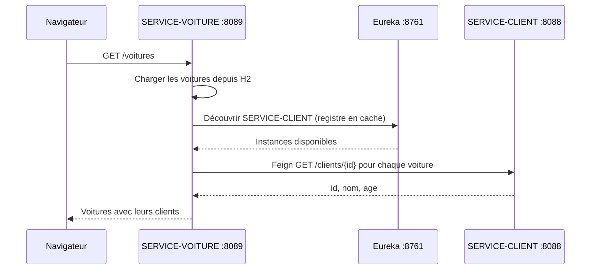
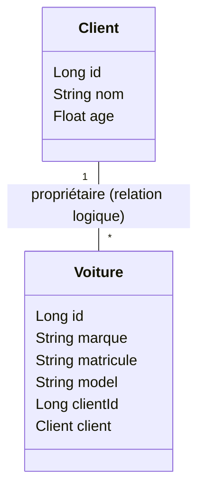

# TP 19 — Eureka, Client et Gateway

Implémentation des étapes 2 à 7 fournies : Eureka, Client, Gateway et Voiture avec OpenFeign.

## Prérequis

- JDK 17 ou 21 recommandé et Maven 3.6.3+ dans le PATH.
- Spring Boot 3.5.7 et Spring Cloud 2025.0.0 : versions compatibles selon la [matrice officielle](https://spring.io/projects/spring-cloud).
- Ports 8761, 8088, 8888 et 8089 disponibles.

## Compiler et tester

Depuis la racine :

```powershell
mvn clean verify
```

Le test d'intégration du service Client utilise un serveur HTTP réel sur un port aléatoire, sans Eureka. Il vérifie les données initiales, le CRUD, les réponses 404 et le health check.

## Démarrer

Dans un premier terminal :

```powershell
mvn -pl eureka-server spring-boot:run
```

Puis dans un deuxième terminal :

```powershell
mvn -pl service-client spring-boot:run
```

Dans IntelliJ, importer le `pom.xml` racine comme projet Maven, choisir un JDK compatible et lancer `EurekaServerApplication`, puis `ClientApplication`.

## Vérifier

- Registre : <http://localhost:8761/>. Attendre l'apparition de `SERVICE-CLIENT` avec le statut `UP` (l'enregistrement peut prendre quelques secondes).
- Liste : <http://localhost:8088/clients>.
- Premier client : <http://localhost:8088/client/1> (alias `/clients/1`).
- Santé : <http://localhost:8088/actuator/health>.
- Console H2 : <http://localhost:8088/h2-console>, URL JDBC `jdbc:h2:mem:clients`, utilisateur `sa`, mot de passe vide.

La liste contient Rabab SELIMANI (23), Amal RAMI (22) et Samir SAFI (22). La base en mémoire est recréée à chaque démarrage.

| Méthode | Chemin | Résultat |
| --- | --- | --- |
| GET | `/clients` | Liste des clients |
| GET | `/client/{id}` ou `/clients/{id}` | Client, ou 404 |
| POST | `/clients` | Création, statut 201 et en-tête Location |
| PUT | `/clients/{id}` | Modification, ou 404 |
| DELETE | `/clients/{id}` | Suppression, statut 204, ou 404 |

Exemple de création dans PowerShell :

```powershell
Invoke-RestMethod -Method Post -Uri http://localhost:8088/clients -ContentType 'application/json' -Body '{"nom":"Nouveau client","age":25}'
```

Le code suit les couches `controllers`, `services`, `repositories`, `entities`. L'export automatique du repository Data REST est désactivé pour laisser les endpoints au contrôleur. La console H2 et les identifiants vides sont prévus pour ce TP local.

## Étape 5 — Gateway statique

Lancer Eureka et Client comme indiqué ci-dessus, puis la Gateway dans un troisième terminal :

```powershell
mvn -pl gateway spring-boot:run "-Dspring-boot.run.profiles=static"
```

Dans IntelliJ, recharger Maven pour importer le module `gateway`, puis lancer la configuration `gateway-static` pour cette étape. `Start All` lance les trois applications avec des consoles séparées. `Start Both` conserve le lancement d'Eureka et Client uniquement.

La Gateway écoute sur le port 8888. Les routes de `gateway/src/main/resources/application-static.properties` transmettent `/clients`, `/clients/**` et `/client/**` à `http://localhost:8088`, en conservant le chemin. La découverte et l'enregistrement Eureka de la Gateway sont désactivés. Le profil `static` active cette configuration.

Tester :

- <http://localhost:8888/clients> → <http://localhost:8088/clients>
- <http://localhost:8888/client/1> → <http://localhost:8088/client/1>
- <http://localhost:8888/actuator/health>

Le service Client doit être démarré pour que les routes fonctionnent.

## Étape 6 — Routage avec Eureka

La Gateway utilise maintenant Eureka par défaut. Chaque application possède son fichier `src/main/resources/application.properties`. Le service Client possède déjà la configuration d'enregistrement `SERVICE-CLIENT`. La Gateway s'enregistre sous `GATEWAY` et interroge le même registre sur le port 8761. Ses routes `lb://SERVICE-CLIENT` sont définies dans la classe principale `GatewayApplication`, conformément à l'étape 6.

Dans IntelliJ, recharger Maven, arrêter les anciennes instances puis lancer `Start All`, ou démarrer successivement `eureka-server`, `service-client`, puis `gateway`. Chaque application garde sa propre console. Ne pas lancer `gateway-static` et `gateway` simultanément : elles utilisent le même port 8888.

En terminal, après avoir démarré Eureka et Client :

```powershell
mvn -pl gateway spring-boot:run
```

Deux modes de résolution coexistent :

- Le bean `clientRoutes` transmet `/clients`, `/clients/**` et `/client/**` à `lb://SERVICE-CLIENT`. Eureka fournit les instances et Spring Cloud LoadBalancer sélectionne la destination. Aucun port Client n'est fixé dans ces routes.
- Le discovery locator génère les routes par nom logique, par exemple `/SERVICE-CLIENT/clients`. Il retire le préfixe `/SERVICE-CLIENT` avant de transmettre la requête. Il est activé par configuration, ce qui remplace la déclaration manuelle du bean alternatif dans les captures.

Tester :

- <http://localhost:8888/clients>
- <http://localhost:8888/client/1>
- <http://localhost:8888/SERVICE-CLIENT/clients>
- <http://localhost:8888/SERVICE-CLIENT/client/1>

Dans <http://localhost:8761/>, vérifier la présence de `SERVICE-CLIENT` et `GATEWAY` avec le statut `UP`. Au premier démarrage, attendre la propagation du registre (environ une minute possible). Une réponse 503 sur une route `lb://` peut indiquer qu'aucune instance Client n'est encore connue.

L'étape 5 reste disponible avec le profil `static`. Le bean de routes Eureka est désactivé dans ce profil pour éviter de mélanger les routes des deux étapes.

Les propriétés utilisent `spring.cloud.gateway.server.webflux`, adapté au [starter Gateway WebFlux 4.3](https://docs.spring.io/spring-cloud-gateway/reference/4.3/spring-cloud-gateway-server-webflux/starter.html) du projet.

### Vérification automatique des routes

Après `mvn package`, lancer :

```powershell
.\scripts\Test-Gateway.ps1 -JavaPath "$env:JAVA_HOME\bin\java.exe"
```

Ce test démarre de vraies applications sur les ports isolés 18761, 18088, 18888 et 18889, vérifie les routes publiques et par nom de service, l'enregistrement Eureka et le profil statique. Le port Client différent de 8088 vérifie que le routage Eureka utilise bien la découverte. Les processus de test sont arrêtés automatiquement. Utiliser un JDK compatible avec Spring Boot, par exemple 17, 21 ou 25.

## Étape 7 — SERVICE-VOITURE et OpenFeign

Le module `service-voiture` écoute sur le port 8089, avec sa configuration dans `service-voiture/src/main/resources/application.properties`. Il possède sa propre base H2 `jdbc:h2:mem:voitures` et s'enregistre dans Eureka sous `SERVICE-VOITURE`.

Recharger Maven dans IntelliJ pour importer le module. Démarrer `eureka-server`, `service-client`, puis `service-voiture`. La configuration `Start All` lance désormais les quatre applications dans des consoles séparées, Gateway comprise. En terminal :

```powershell
mvn -pl service-voiture spring-boot:run
```

Attendre l'enregistrement et la synchronisation Eureka avant de tester :

| URL | Résultat |
| --- | --- |
| <http://localhost:8089/voitures> | Trois voitures avec leurs clients |
| <http://localhost:8089/voiture/1> | Toyota Corolla avec le client 1 |
| <http://localhost:8089/voitures/1> | Alias de la consultation par identifiant |
| <http://localhost:8089/voitures/client/1> | Deux voitures appartenant au client 1 |
| <http://localhost:8888/SERVICE-VOITURE/voitures> | Même liste à travers la Gateway et son discovery locator |
| <http://localhost:8089/actuator/health> | Santé du service |

La console H2 est disponible sur <http://localhost:8089/h2-console> : URL JDBC `jdbc:h2:mem:voitures`, utilisateur `sa`, mot de passe vide. Les données sont réinitialisées au démarrage.

### Structure et communication

`VoitureApplication` active OpenFeign avec `@EnableFeignClients`. L'interface `clients.ClientService` porte `@FeignClient(name = "SERVICE-CLIENT")` et appelle `/clients/{id}`. Elle utilise Eureka et Spring Cloud LoadBalancer, sans URL Client fixe, conformément au [fonctionnement OpenFeign](https://docs.spring.io/spring-cloud-openfeign/reference/spring-cloud-openfeign.html).



La structure suit les couches `controllers`, `services`, `repositories`, `entities`, avec `clients` pour l'interface Feign et `models` pour le POJO Client.



Le champ Java `clientId` est harmonisé avec `getClientId`, `setClientId` et `findByClientId` ; la colonne H2 s'appelle `id_client`. Le POJO `Client` n'est pas une entité de la base Voiture. Le champ `client` est donc uniquement `@Transient`, sans `@ManyToOne` : les deux bases restent indépendantes. Il est rempli à chaque lecture par Feign.

Le `CommandLineRunner` reprend le code fourni dans le TP : appels Feign pour les clients 2 et 1, affichages console, puis trois appels `save` avec les identifiants 1, 2 et 3. Démarrer Eureka et Client et attendre leur synchronisation avant de lancer Voiture. Les identifiants Voiture sont attribués manuellement : son champ `id` porte uniquement `@Id`, sans `@GeneratedValue`, pour conserver ces insertions et éviter le conflit de persistance. Les constructeurs et accesseurs sont écrits en Java pour conserver la correction du problème Lombok/JDK rencontré précédemment. HATEOAS est fourni par le starter Spring Boot géré par le BOM.

Une voiture inexistante retourne 404. Une indisponibilité de Client retourne 503 ; si son propriétaire a été supprimé, la consultation retourne 502. Le service Voiture expose les lectures demandées dans cette étape ; le CRUD Client reste inchangé.

### Tester la chaîne complète

Après compilation des quatre modules :

```powershell
.\scripts\Test-Gateway.ps1 -JavaPath "$env:JAVA_HOME\bin\java.exe" -IncludeVoiture
```

Le test ajoute Voiture sur le port isolé 18089, vérifie les trois propriétaires, le filtrage par client, les réponses 404, le passage via Gateway et l'enregistrement Eureka. Il modifie ensuite un client de test pour vérifier que Feign récupère ses nouvelles données, sans copie persistée dans Voiture. Tous les processus de test sont arrêtés automatiquement.

